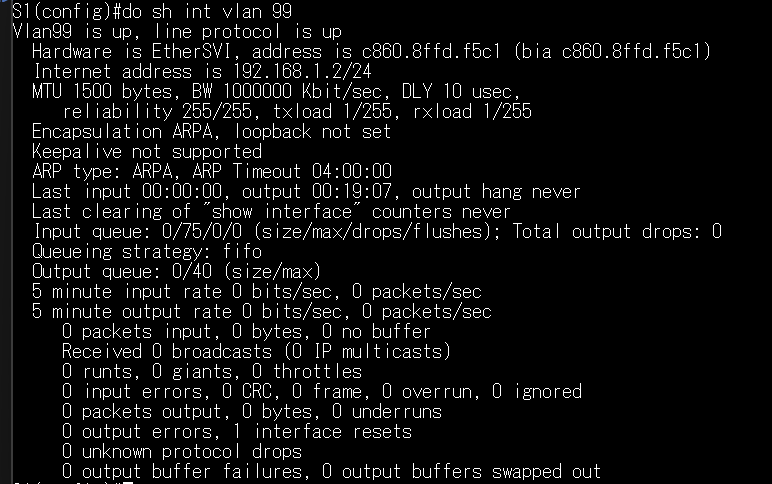
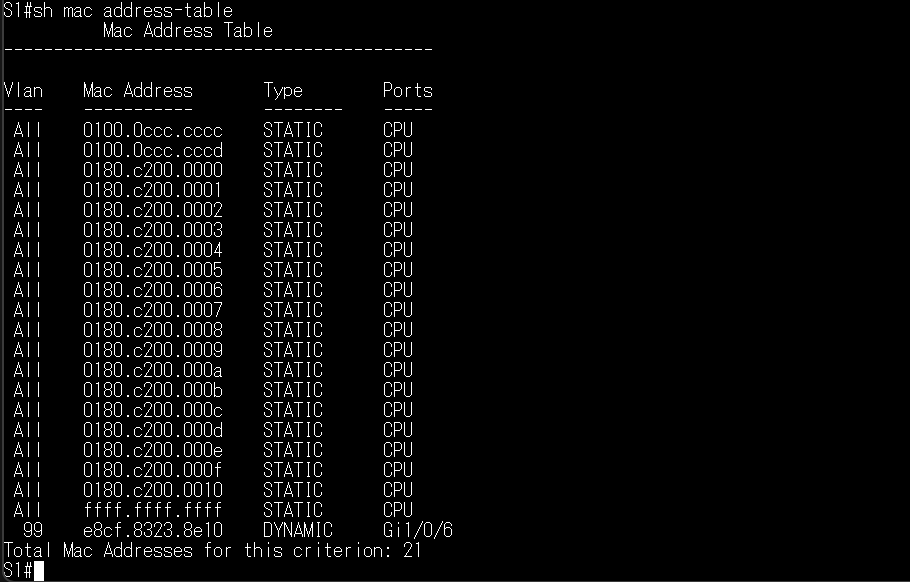
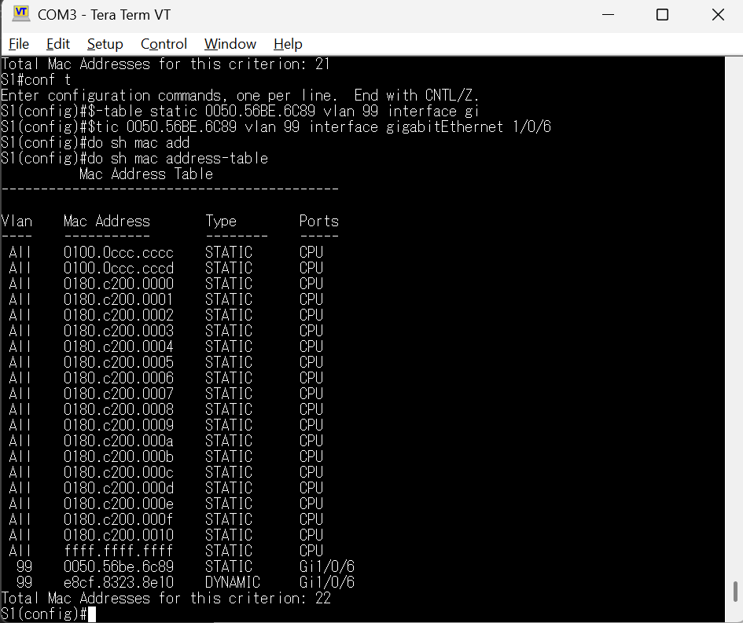

# Cisco Switch Configuration & SSH Troubleshooting

## Overview

This project documents a hands-on networking lab completed
at Centennial College using a physical Cisco Catalyst 1000
switch running Cisco IOS 15.2(7)E6.

The objective was to configure a managed switch, establish
IPv4/IPv6 connectivity, enable remote administration,
and investigate MAC address learning.

## Technologies

- Cisco Catalyst 1000
- Cisco IOS
- VLANs and Switch Virtual Interfaces (SVIs)
- IPv4 and IPv6
- SSHv2
- Windows PowerShell
- MAC address tables

## Network Configuration

The management interface was configured on VLAN 99.

| Device | Interface | IPv4 Address |
|--------|-----------|--------------|
| Switch S1 | VLAN 99 | 192.168.1.2/24 |
| PC-A | Ethernet | 192.168.1.10/24 |

IPv6 connectivity was also configured and verified.

### Management VLAN Verification

The switch was configured with VLAN 99 as its management VLAN.

After assigning an active switch port to VLAN 99, the Switch
Virtual Interface (SVI) became operational, with both the
interface and line protocol reporting an up/up status.

The following screenshot shows the verification performed
on the physical Cisco Catalyst 1000 switch.

### MAC Address Learning

The switch automatically learned the connected PC's
MAC address and associated it with the corresponding
interface in VLAN 99.

### Static MAC Address Configuration

I manually configured a static MAC address entry
to associate the connected PC with a specific
switch interface.

## Troubleshooting: SSH Compatibility

While attempting to connect to the switch using Windows
PowerShell, the SSH connection failed because the switch
offered legacy SHA-1-based key exchange algorithms.

After investigating the available algorithms, I successfully
established an SSH connection using temporary,
connection-specific compatibility options.

This workaround was used only in an isolated educational
environment and is not recommended for production systems.

## Verification

- Management VLAN 99 operational
- IPv4 connectivity verified
- IPv6 connectivity verified
- Remote SSH access established
- MAC address learning examined

## Key Takeaways

- Understanding how management VLANs operate
- Configuring and troubleshooting remote access
- Distinguishing connectivity failures from SSH
  cryptographic negotiation problems
- Using Cisco IOS verification commands

