# Cisco Router Configuration — IPv4, IPv6 & SSH

## Overview

This project documents a hands-on Cisco router configuration lab completed as part of the CNET 217 Switching & Routing Essentials course at Centennial College.

The objective was to configure and secure a Cisco router, establish IPv4/IPv6 connectivity between separate networks, enable SSH remote administration, and verify routing and interface information.

The lab was performed using physical Cisco networking equipment.

**Status:** Completed

## Technologies

- Cisco ISR Router — IOS XE
- Cisco IOS CLI
- IPv4 and IPv6
- SSHv2 
- RSA Host Keys
- IPv6 SLAAC
- Windows PowerShell
- Tera Term

## Network Topology

The network consists of one router (R1), one switch (S1), and two Windows workstations.

PC-A connects to R1 through S1, while PC-B connects directly to R1.

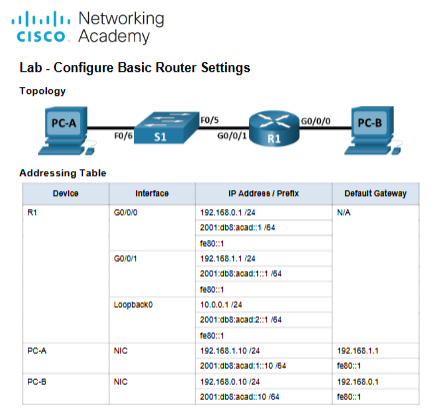

### Physical Lab Environment

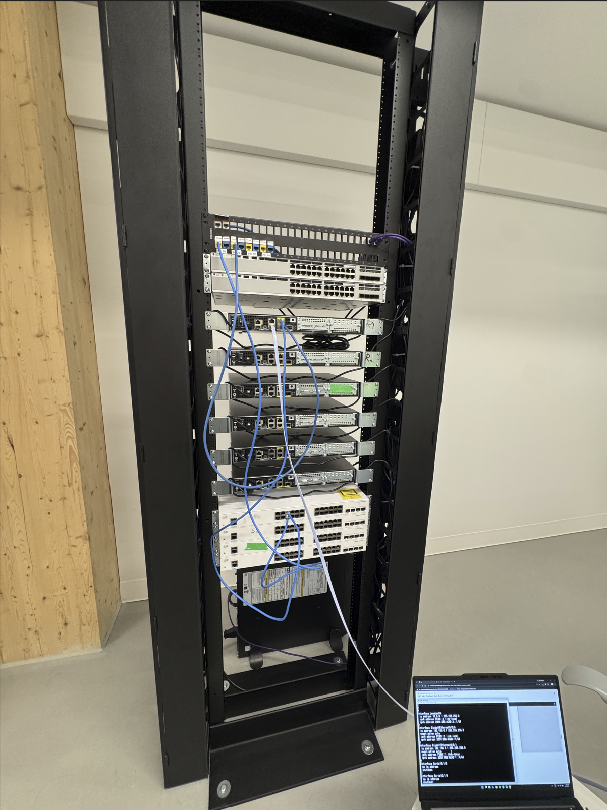

### IP Addressing

| Device | Interface | IPv4 Address | IPv6 Address |
|--------|-----------|--------------|--------------|
| R1 | G0/0/0 | 192.168.0.1/24 | 2001:db8:acad::1/64 |
| R1 | G0/0/1 | 192.168.1.1/24 | 2001:db8:acad:1::1/64 |
| R1 | Loopback0 | 10.0.0.1/24 | 2001:db8:acad:2::1/64 |
| PC-A | Ethernet | 192.168.1.10/24 | 2001:db8:acad:1::10/64 |
| PC-B | Ethernet | 192.168.0.10/24 | 2001:db8:acad::10/64 |

## Router Configuration

The router was configured with the following features:

- Hostname, domain name, and basic device settings
- Local user authentication and privileged EXEC access
- RSA key generation and SSHv2
- Console and VTY security
- Login attempt restrictions and inactivity timeouts
- IPv4 and IPv6 addressing
- IPv6 unicast routing
- Loopback interface configuration
- Saved startup configuration

Authentication secrets are intentionally excluded from this public repository.

### Interface Configuration

The router's physical interfaces and Loopback0 were configured with IPv4 and IPv6 addresses.

Example configuration:

```cisco
interface GigabitEthernet0/0/0
 description Connection to PC-B
 ip address 192.168.0.1 255.255.255.0
 ipv6 address 2001:db8:acad::1/64
 ipv6 address fe80::1 link-local
 no shutdown

interface GigabitEthernet0/0/1
 description Connection to S1
 ip address 192.168.1.1 255.255.255.0
 ipv6 address 2001:db8:acad:1::1/64
 ipv6 address fe80::1 link-local
 no shutdown

interface Loopback0
 ip address 10.0.0.1 255.255.255.0
 ipv6 address 2001:db8:acad:2::1/64
```

### Interface Verification

The following commands were used to verify IPv4/IPv6 addressing and interface status:

```cisco
show ip interface brief
show ipv6 interface brief
```

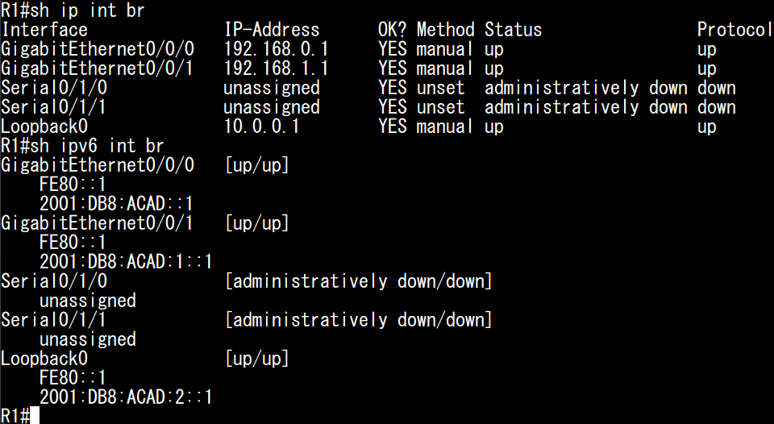

Both GigabitEthernet interfaces and Loopback0 were operational.

## Network Connectivity

### Workstation Configuration

Both Windows workstations were initially configured with static IPv4 and IPv6 addresses and appropriate default gateways.

IPv6 autoconfiguration was also examined during the lab.

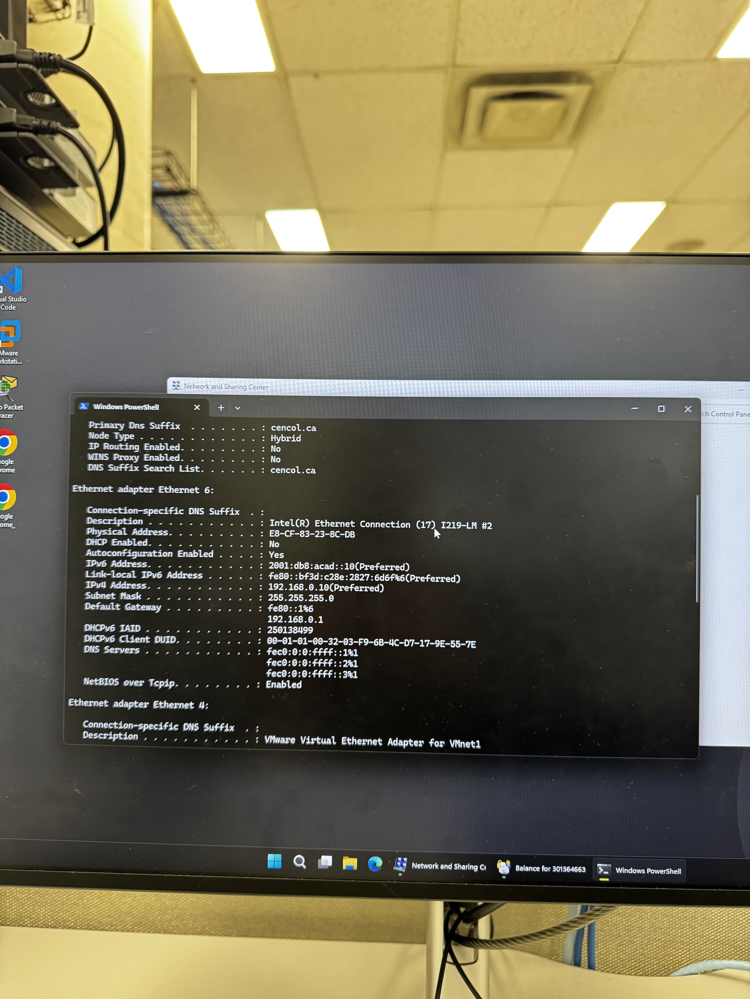

### IPv4 and IPv6 Verification

Connectivity between PC-A and PC-B was tested using Windows PowerShell.

```powershell
ping 192.168.0.10
ping 2001:db8:acad::10
```

Both tests completed successfully with 0% packet loss.

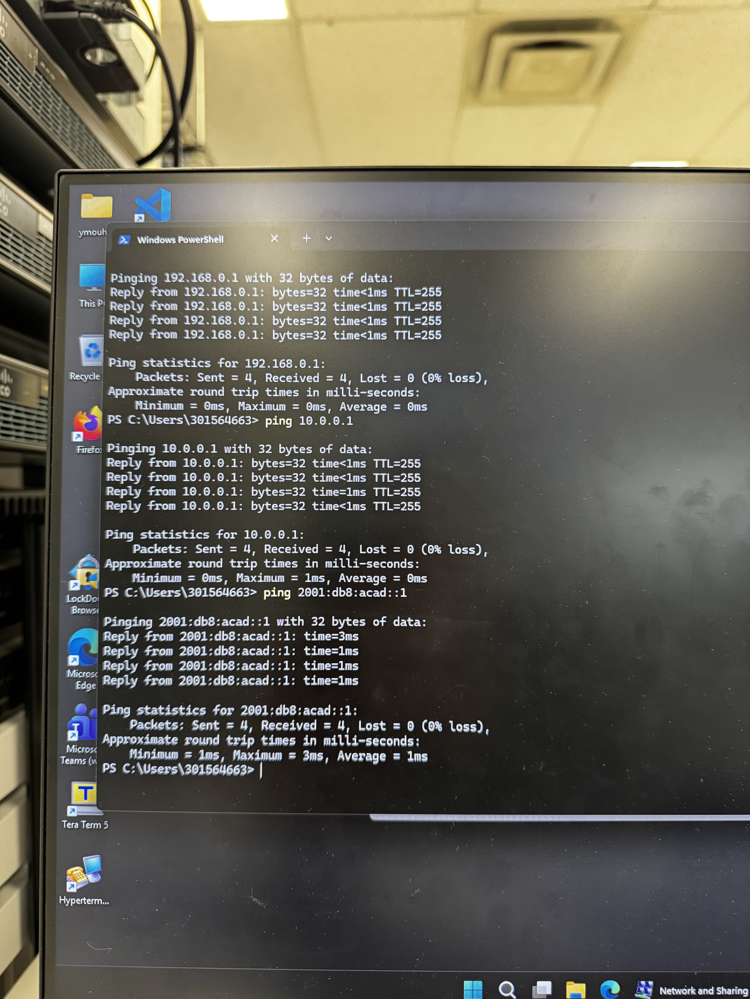

These results confirmed successful routing between the connected networks.

## SSH Remote Administration

SSH version 2 was configured to provide encrypted remote access to the router.

Remote administration was tested using both IPv4 and IPv6 loopback addresses.

### IPv4 SSH

The router was successfully accessed through its IPv4 loopback address:

```powershell
ssh SSHadmin@10.0.0.1
```

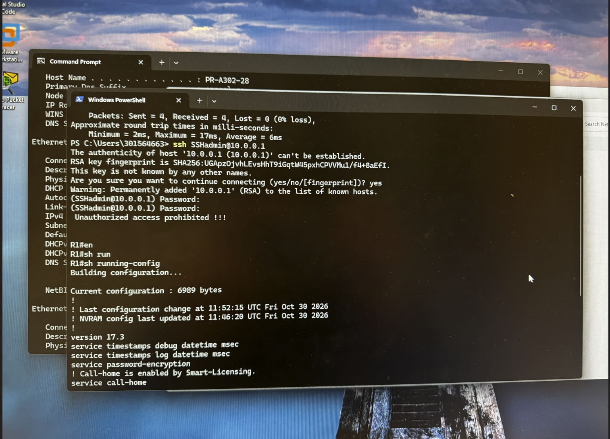

### IPv6 SSH & Troubleshooting

An initial SSH connection over IPv6 failed because the router offered legacy SHA-1-based key-exchange algorithms that were disabled by default in Windows OpenSSH.

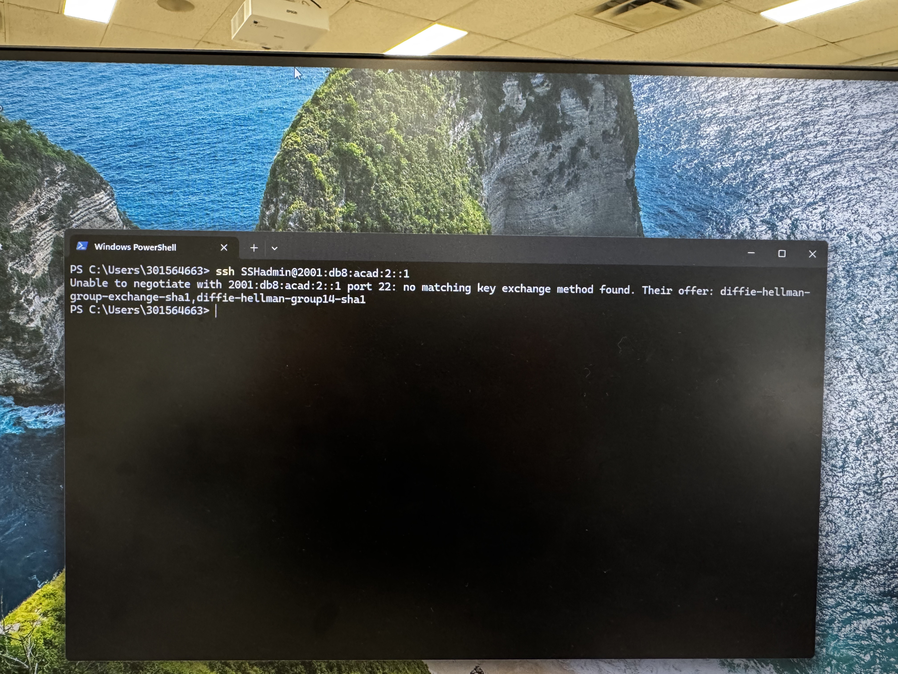

After identifying the compatibility issue, I established the connection using temporary, connection-specific options:

```powershell
ssh -o KexAlgorithms=+diffie-hellman-group14-sha1 -o HostKeyAlgorithms=+ssh-rsa SSHadmin@2001:db8:acad:2::1
```

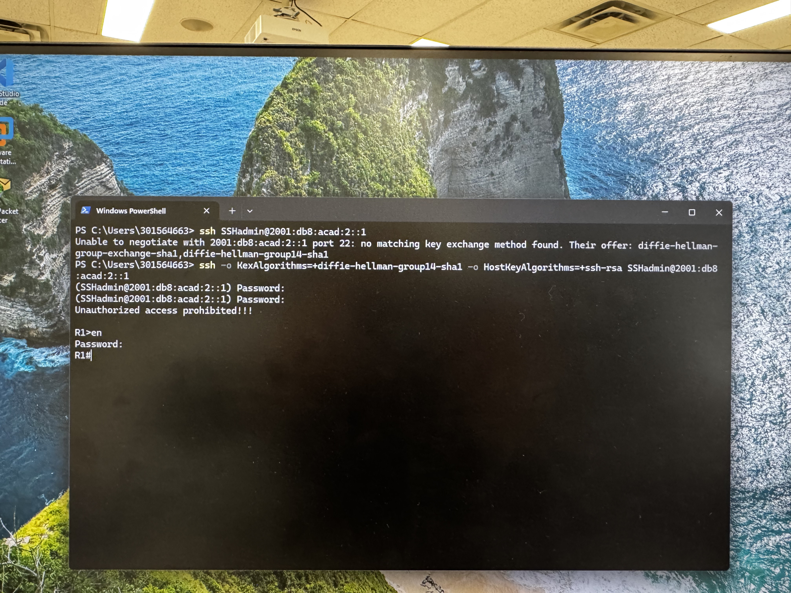

The workaround was used only in an isolated educational environment. Legacy cryptographic algorithms are not recommended for production systems.

### Login Security

The router was also configured to temporarily block remote login attempts after repeated authentication failures.

```cisco
login block-for 120 attempt 3 within 60
```

The configuration was verified using:

```cisco
show login
```

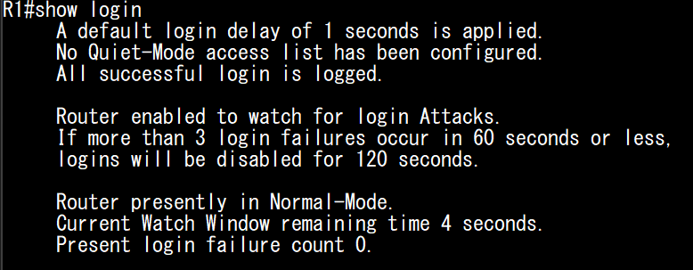

## Router Information & Verification

### IOS and Hardware Information

Router information was retrieved using:

```cisco
show version
```

| Property | Observed Value |
|----------|----------------|
| Router Model | Cisco ISR 4221 |
| IOS XE Version | 16.09.04 |
| NVRAM | 32768K |
| Flash Memory | 7086079K |
| Configuration Register | 0x2102 |

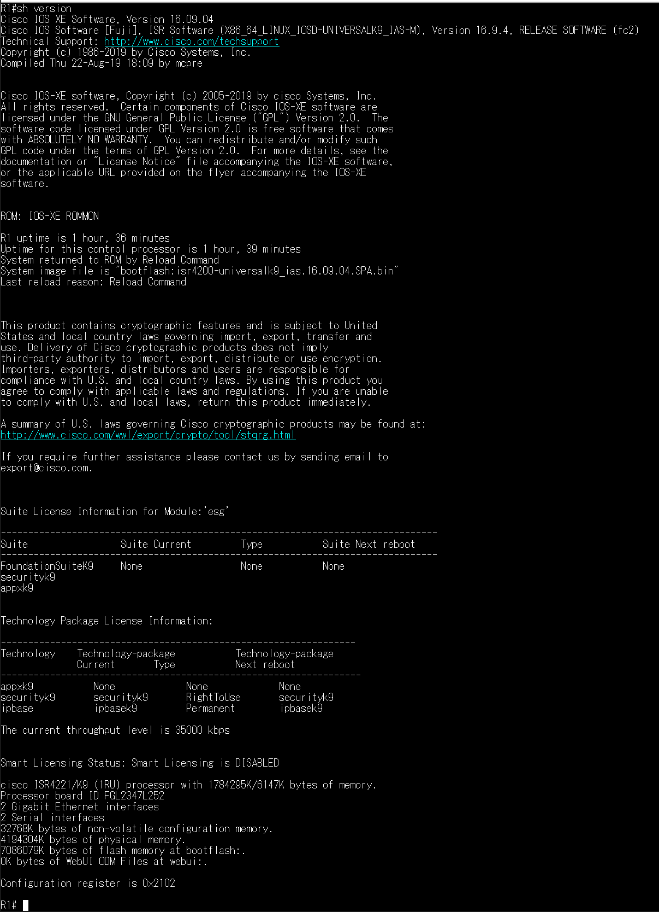

### Routing Table

The routing table was examined using:

```cisco
show ip route
```

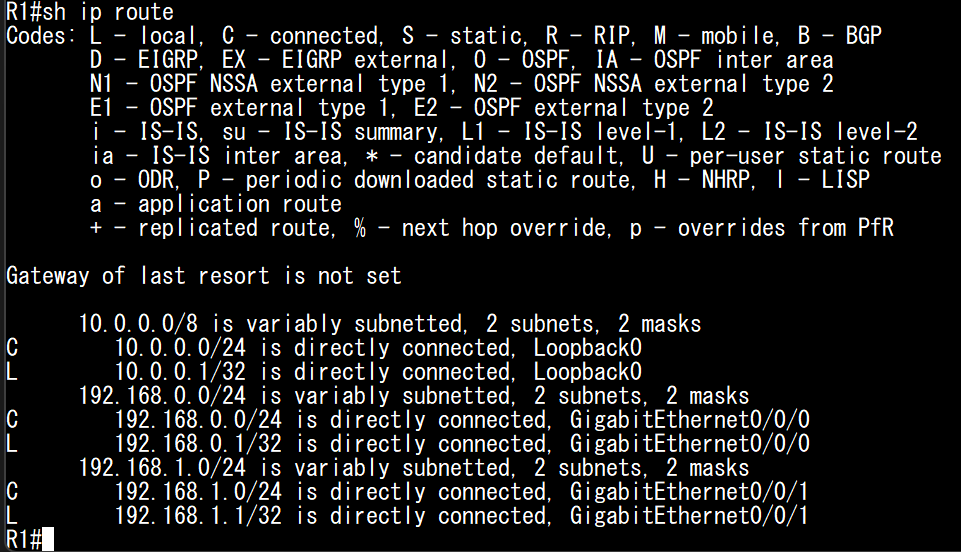

Three directly connected networks were identified:

| Network | Interface |
|---------|-----------|
| 192.168.0.0/24 | G0/0/0 |
| 192.168.1.0/24 | G0/0/1 |
| 10.0.0.0/24 | Loopback0 |

The `C` route code identifies directly connected networks.

### IPv6 Autoconfiguration

The lab explored IPv6 Stateless Address Autoconfiguration (SLAAC), which allows hosts to configure IPv6 addresses using router advertisements.

PC-B's IPv6 settings were examined to understand the differences between static addressing and SLAAC.

IPv6 connectivity to the router was successfully verified.

## Verification Summary

| Verification | Result |
|--------------|--------|
| Basic router configuration | Completed |
| IPv4/IPv6 interface configuration | Completed |
| IPv4 connectivity | Successful |
| IPv6 connectivity | Successful |
| IPv4 SSH remote access | Successful |
| IPv6 SSH remote access | Successful |
| SSH compatibility troubleshooting | Resolved |
| Login security configuration | Verified |
| Routing table analysis | Completed |
| Router hardware and IOS verification | Completed |
| IPv6 autoconfiguration | Observed |

## Key Takeaways

This lab strengthened my understanding of Cisco router configuration, IPv4/IPv6 connectivity, and secure remote administration.

I gained practical experience configuring physical and logical interfaces, examining routing tables, and verifying network connectivity.

The most valuable troubleshooting exercise involved identifying and resolving an SSH cryptographic compatibility issue, reinforcing the distinction between network connectivity problems and SSH negotiation failures.

---

**Environment:** Physical Cisco Networking Laboratory — Centennial College

**Curriculum:** Cisco CCNA — Switching, Routing, and Wireless Essentials
