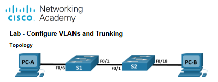

# Cisco VLAN Configuration & 802.1Q Trunking

## Overview

This project documents Cisco Lab 3.4.6, completed as part of the
CNET 217 Switching & Routing Essentials course at Centennial College.

The lab involved configuring VLANs across two Cisco switches,
assigning access ports, managing VLAN databases, and establishing
inter-switch connectivity through IEEE 802.1Q trunking.

The objective was to understand how VLANs segment Layer 2 networks
and how trunk links allow traffic from multiple VLANs to travel
between switches.

## Technologies

- Cisco IOS
- Cisco Catalyst switches
- VLANs
- IEEE 802.1Q
- Dynamic Trunking Protocol (DTP)
- Switch Virtual Interfaces (SVIs)
- IPv4
- Cisco IOS CLI

## Network Topology

The lab used two interconnected switches and two PCs.



Both PCs were assigned to VLAN 10, while VLAN 99 was used
for switch management.

### IP Addressing

| Device | Interface | IPv4 Address |
|--------|-----------|--------------|
| S1 | Management SVI | 192.168.1.11/24 |
| S2 | Management SVI | 192.168.1.12/24 |
| PC-A | Ethernet | 192.168.10.3/24 |
| PC-B | Ethernet | 192.168.10.4/24 |

## VLAN Configuration

Four VLANs were created on both switches.

| VLAN ID | Name | Purpose |
|---------|------|---------|
| 10 | Operations | End-user devices |
| 20 | Parking_Lot | Unused switch ports |
| 99 | Management | Switch management |
| 1000 | Native | Native VLAN for trunk links |

### Creating VLANs

Example Cisco IOS configuration:

```cisco
configure terminal

vlan 10
 name Operations

vlan 20
 name Parking_Lot

vlan 99
 name Management

vlan 1000
 name Native
```

The VLAN database was verified using:

```cisco
show vlan brief
```

## Access Port Configuration

The PC-facing interfaces were configured as access ports
belonging to VLAN 10.

Example configuration:

```cisco
interface GigabitEthernet1/0/6
 switchport mode access
 switchport access vlan 10
```

This associates the connected device with VLAN 10.

The assigned VLAN determines the Layer 2 broadcast domain
to which the device belongs.

## Management VLAN Configuration

The management IP addresses were moved from VLAN 1
to VLAN 99.

Example S1 configuration:

```cisco
interface vlan 1
 no ip address

interface vlan 99
 ip address 192.168.1.11 255.255.255.0
 no shutdown
```

Example S2 configuration:

```cisco
interface vlan 1
 no ip address

interface vlan 99
 ip address 192.168.1.12 255.255.255.0
 no shutdown
```

### Initial SVI Troubleshooting

After configuring VLAN 99, the management SVI initially
reported an up/down state.

Although the interface was administratively enabled,
VLAN 99 had no active Layer 2 forwarding path.

This demonstrated that an SVI requires an operational VLAN
with active forwarding connectivity to become fully operational.

## VLAN Database Management

The lab included several VLAN maintenance operations.

### Reassigning Ports

Multiple interfaces were assigned to a VLAN using
`interface range`.

Individual ports were then reassigned to different VLANs.

### Removing a Port Assignment

The command:

```cisco
no switchport access vlan
```

restored the interface's default access VLAN assignment.

The port returned to VLAN 1.

### Deleting a VLAN

The lab also demonstrated the behavior of an access port
when its assigned VLAN is deleted.

For example:

```cisco
no vlan 30
```

The interface retained its VLAN 30 assignment, even though
VLAN 30 no longer existed in the VLAN database.

As a result, normal traffic forwarding for that VLAN was
interrupted.

This demonstrated why interfaces should be reassigned
before removing their associated VLAN.

## 802.1Q Trunk Configuration

### Initial Connectivity Problem

Before trunking was configured, both PCs belonged to VLAN 10,
but the inter-switch link did not carry VLAN 10 traffic.

Therefore, PC-A could not communicate with PC-B.

### Dynamic Trunk Negotiation

The lab explored trunk negotiation using Dynamic Trunking
Protocol (DTP).

The configuration included:

```cisco
switchport mode dynamic desirable
```

Trunk status was inspected using:

```cisco
show interfaces trunk
```

After the trunk was established, traffic from VLAN 10
could pass between both switches.

### Manual Trunk Configuration

The inter-switch interfaces were subsequently configured
as static trunks.

```cisco
interface GigabitEthernet1/0/1
 switchport mode trunk
 switchport trunk native vlan 1000
```

The native VLAN was configured consistently on both
ends of the trunk.

Trunk status was verified with:

```cisco
show interfaces trunk
```

### Why Configure Trunks Manually?

Manually configured trunks provide explicit control
over which interfaces operate as trunk links.

This reduces reliance on automatic DTP negotiation
and helps prevent unintended trunk formation.

### Why Change the Native VLAN?

The native VLAN was changed from VLAN 1 to VLAN 1000.

Using a dedicated, otherwise unused native VLAN is
a common network-hardening practice.

The native VLAN must match on both ends of the trunk.

## Connectivity Verification

The lab demonstrated how VLAN configuration affects
network communication.

| Connectivity Test | Before Trunking | After Trunking |
|-------------------|-----------------|----------------|
| PC-A → PC-B | Failed after VLAN assignment | Successful |
| S1 → S2 | Failed when VLAN 99 lacked a forwarding path | Successful |
| PC-A → S1 | Failed | Failed |
| PC-B → S2 | Failed | Failed |

### Analysis

After trunking was enabled:

- PC-A could communicate with PC-B because both belonged to VLAN 10.
- S1 could communicate with S2 through management VLAN 99.
- The PCs could not communicate with the switch management interfaces because VLAN 10 and VLAN 99 were separate IP subnets.

Communication between VLAN 10 and VLAN 99 would require inter-VLAN routing through a router or Layer 3 switch.

## VLAN Database Reset

The final section examined VLAN database storage.

The switch flash directory was inspected using:

```cisco
show flash:
```

The VLAN database file, `vlan.dat`, was identified and
removed as part of the authorized lab reset procedure.

The startup configuration was also erased, and the
switches were reloaded to restore their initial state.

These operations were performed only on assigned
educational lab equipment.

## Verification Summary

| Task | Result |
|------|--------|
| Basic switch configuration | Completed |
| VLAN creation | Completed |
| Access port configuration | Completed |
| Management VLAN configuration | Completed |
| VLAN reassignment | Completed |
| VLAN deletion and troubleshooting | Completed |
| DTP negotiation | Completed |
| Manual 802.1Q trunking | Completed |
| Native VLAN configuration | Completed |
| Connectivity verification | Completed |
| VLAN database reset | Completed |

## Key Takeaways

This lab strengthened my understanding of VLAN segmentation,
access ports, and inter-switch trunking.

The most valuable troubleshooting exercise involved identifying
why devices in the same VLAN could not communicate before
trunking was configured.

I also learned how deleting a VLAN affects assigned interfaces,
why management SVIs depend on active Layer 2 connectivity,
and why inter-VLAN routing is required for communication
between separate networks.

These concepts are fundamental to designing, configuring,
and troubleshooting switched networks.
