# Cisco Inter-VLAN Routing — Router-on-a-Stick

## Overview

This project documents Cisco Lab 4.5.2 — Implement Inter-VLAN Routing, completed as part of the CNET 217 Switching & Routing Essentials course at Centennial College.

The objective was to configure inter-VLAN communication using a Router-on-a-Stick topology, allowing devices in separate VLANs to communicate through a single physical router interface.

This lab builds on [Project 03 — VLANs and 802.1Q Trunking](../03-vlans-and-trunking) by introducing Layer 3 routing between VLANs.

**Status:** Completed and connectivity verified.

## Technologies

- Cisco IOS and physical Cisco networking equipment
- VLANs and Switch Virtual Interfaces (SVIs)
- IEEE 802.1Q trunking
- Router-on-a-Stick and router subinterfaces
- IPv4 addressing and default gateways
- Cisco IOS CLI, PowerShell, ping and traceroute

## Network Topology

The network consisted of one Cisco router (R1), two Catalyst switches (S1 and S2), and two Windows workstations.

R1 connected to S1 using an 802.1Q trunk link. S1 was also connected to S2 through a trunk link. PC-A and PC-B were placed in separate VLANs to demonstrate inter-VLAN routing through router subinterfaces.

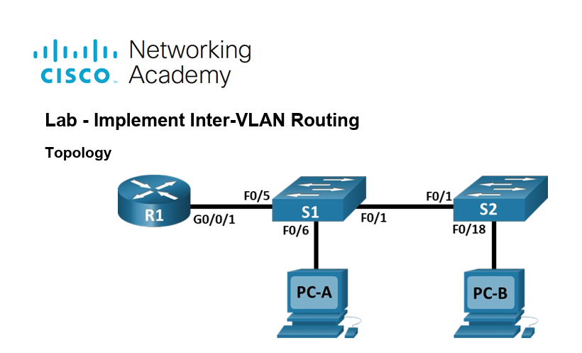

### Physical Lab Environment

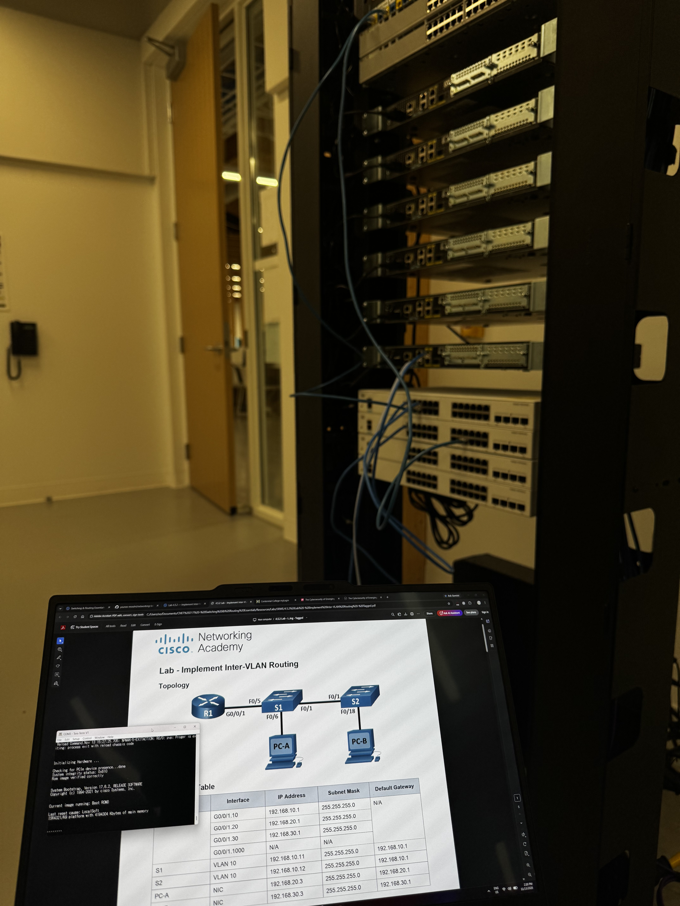

### Physical Equipment

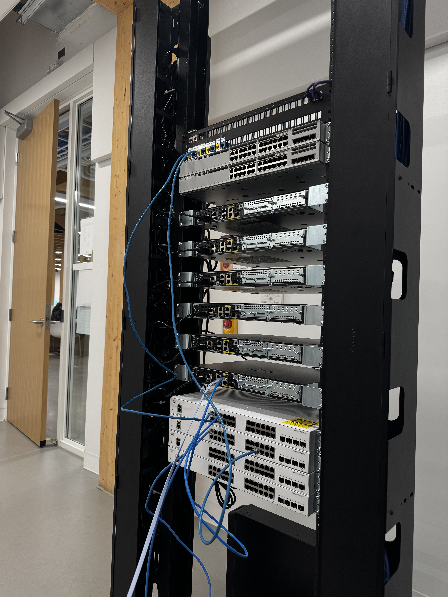

### IP Addressing

| Device | Interface | IPv4 Address | Default Gateway |
|---|---|---|---|
| R1 | G0/0/1.10 | 192.168.10.1/24 | — |
| R1 | G0/0/1.20 | 192.168.20.1/24 | — |
| R1 | G0/0/1.30 | 192.168.30.1/24 | — |
| R1 | G0/0/1.1000 | No IP (native) | — |
| S1 | VLAN 10 | 192.168.10.11/24 | 192.168.10.1 |
| S2 | VLAN 10 | 192.168.10.12/24 | 192.168.10.1 |
| PC-A | Ethernet | 192.168.20.3/24 | 192.168.20.1 |
| PC-B | Ethernet | 192.168.30.3/24 | 192.168.30.1 |

### Workstation Configuration

Both workstations were assigned static IPv4 addresses and their respective router subinterfaces as default gateways.

**PC-A — VLAN 20**

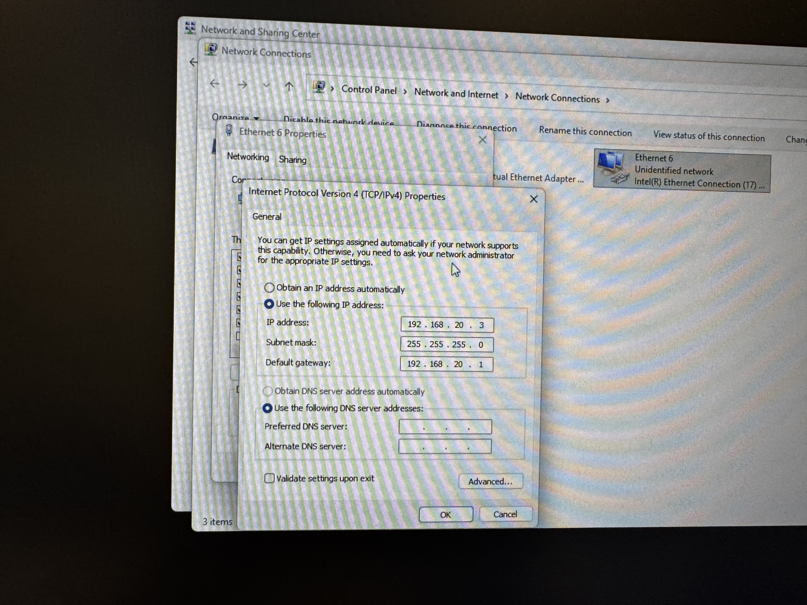

**PC-B — VLAN 30**

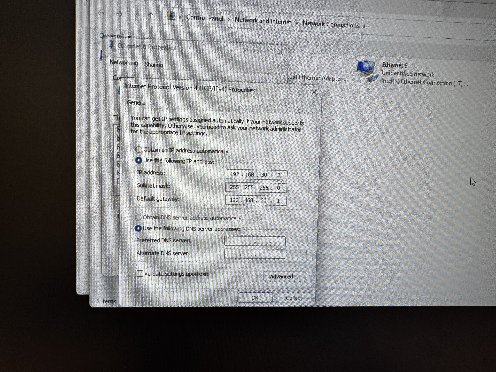

## VLAN Configuration

Five VLANs were created on both switches.

| VLAN ID | Name | Purpose |
|---|---|---|
| 10 | Management | Switch management |
| 20 | Sales | PC-A |
| 30 | Operations | PC-B |
| 999 | Parking_Lot | Unused switch ports |
| 1000 | Native | Native VLAN for trunk links |

PC-A was assigned to VLAN 20 on S1, and PC-B to VLAN 30 on S2. Unused ports were assigned to VLAN 999 and administratively disabled.

Example S1 access-port configuration:

```cisco
interface GigabitEthernet1/0/6
 switchport mode access
 switchport access vlan 20
 no shutdown
```

VLAN membership was verified using `show vlan brief`.

**S1 VLAN Verification**

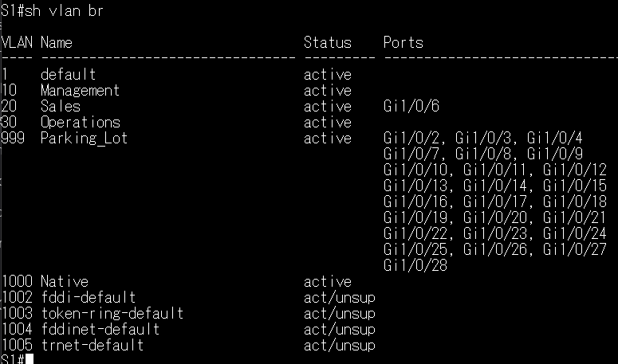

**S2 VLAN Verification**

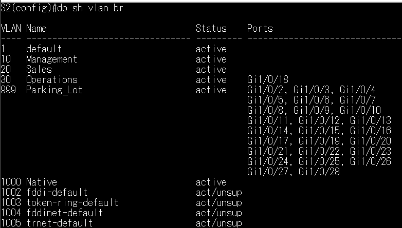

## Management VLAN Configuration

Both switches were configured with management SVIs in VLAN 10 and the router's VLAN 10 subinterface as their default gateway.

Example S1 configuration:

```cisco
interface vlan 10
 ip address 192.168.10.11 255.255.255.0
 no shutdown
exit
ip default-gateway 192.168.10.1
```

The `show ip interface brief` output confirmed that S1's management SVI was operational (`up/up`).

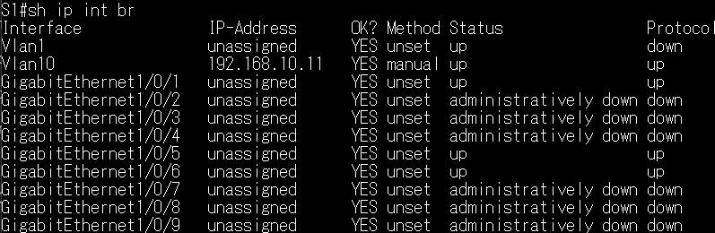

## 802.1Q Trunk Configuration

Static trunk links were configured between S1 and S2, and between S1 and R1.

All trunks used:

- Native VLAN: **1000**
- Allowed VLANs: **10, 20, 30, 1000**
- VLAN 999 excluded from trunk traffic

Example S1 trunk configuration:

```cisco
interface GigabitEthernet1/0/5
 switchport mode trunk
 switchport trunk native vlan 1000
 switchport trunk allowed vlan 10,20,30,1000
 no shutdown
```

Trunk operation was verified with:

```cisco
show interfaces trunk
```

**S1 — Inter-Switch and Router Trunks**

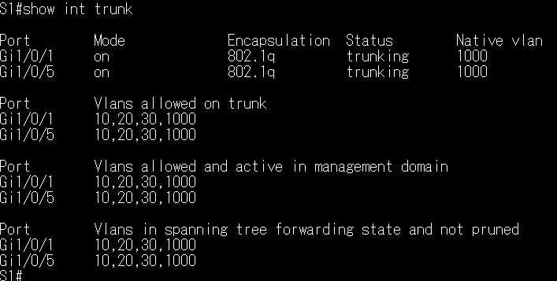

**S2 — Inter-Switch Trunk**

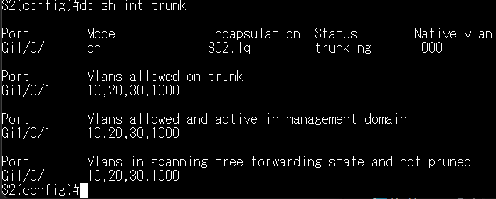

The outputs confirmed that all three configured trunk ports were operational, with the correct native VLAN and allowed VLANs.

## Router-on-a-Stick Configuration

The router's physical interface `G0/0/1` was configured with four logical subinterfaces.

Each routed subinterface provided a default gateway for its associated VLAN.

Example R1 configuration:

```cisco
interface GigabitEthernet0/0/1
 no shutdown

interface GigabitEthernet0/0/1.10
 encapsulation dot1Q 10
 ip address 192.168.10.1 255.255.255.0
 description VLAN 10 Management

interface GigabitEthernet0/0/1.20
 encapsulation dot1Q 20
 ip address 192.168.20.1 255.255.255.0
 description VLAN 20 Sales

interface GigabitEthernet0/0/1.30
 encapsulation dot1Q 30
 ip address 192.168.30.1 255.255.255.0
 description VLAN 30 Operations

interface GigabitEthernet0/0/1.1000
 encapsulation dot1Q 1000 native
 description Native VLAN
```

The native VLAN subinterface did not require an IP address.

### Subinterface Verification

The command `show ip interface brief` confirmed that the physical interface and all four subinterfaces were in the `up/up` state.

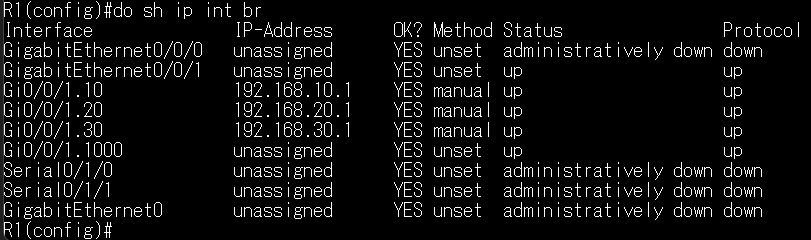

## Inter-VLAN Connectivity Verification

Connectivity was tested from both Windows workstations using ICMP and traceroute.

### PC-A — Ping Tests

| Destination | Purpose | Result |
|---|---|---|
| 192.168.20.1 | Default gateway | Successful |
| 192.168.30.3 | PC-B, different VLAN | Successful |
| 192.168.10.12 | S2 management SVI | Successful |

All three tests returned **4 replies with 0% packet loss**.

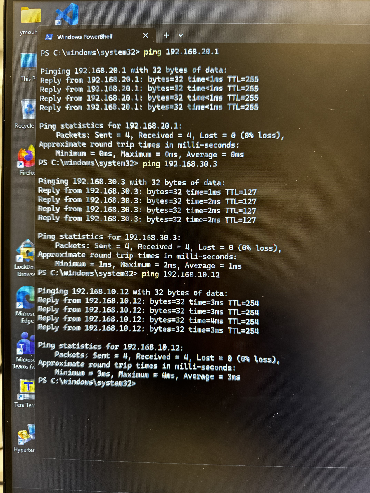

### PC-B — Traceroute

From PC-B, the following command was executed:

```powershell
tracert 192.168.20.3
```

The recorded path was:

| Hop | IP Address | Device |
|---|---|---|
| 1 | 192.168.30.1 | R1 — VLAN 30 gateway |
| 2 | 192.168.20.3 | PC-A — Destination |

This confirmed that traffic between VLAN 30 and VLAN 20 was routed through R1.

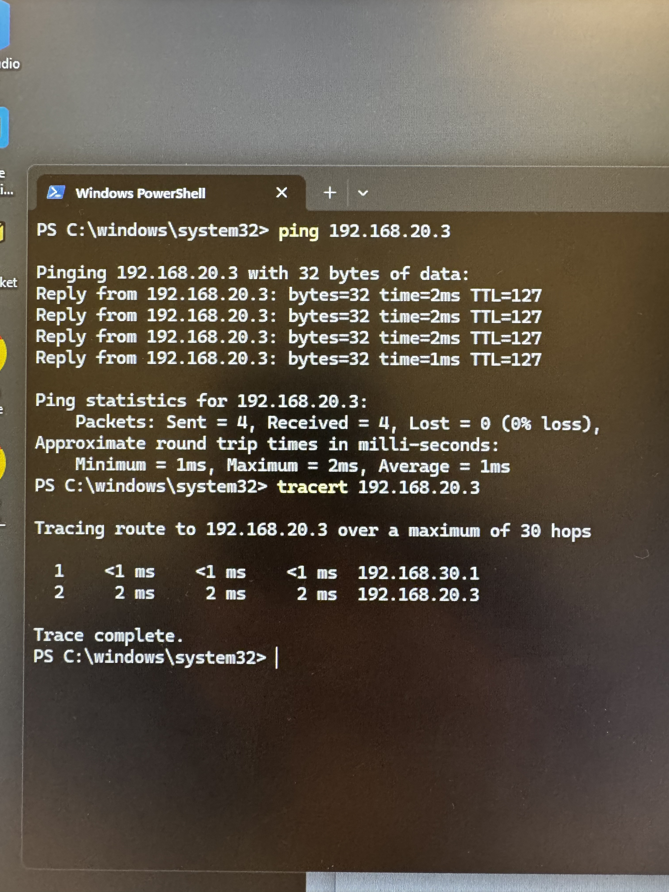

## Troubleshooting and Analysis

The lab reinforced several dependencies of inter-VLAN routing:

- **Trunk configuration:** Required VLANs must be carried across the switch and router links.
- **Default gateways:** Devices must use the correct router subinterface to reach other VLANs.
- **Physical interface state:** If R1's `G0/0/1` interface goes down, its subinterfaces become unavailable, interrupting inter-VLAN communication.
- **VLAN isolation:** Without Layer 3 routing, devices in separate VLANs cannot communicate directly.

No specific fault-resolution incident was recorded for this lab.

## Verification Summary

| Task | Result |
|---|---|
| VLAN and access-port configuration | Completed |
| Management SVI configuration | Verified |
| Static 802.1Q trunks | Verified |
| Router subinterfaces | Verified — up/up |
| PC-A to default gateway | Successful |
| PC-A to PC-B | Successful |
| PC-A to S2 management | Successful |
| PC-B to PC-A traceroute | Successful |

## Key Takeaways

This lab extended my previous VLAN and trunking experience by implementing Layer 3 connectivity using Router-on-a-Stick.

I practiced configuring 802.1Q subinterfaces, assigning VLAN-specific default gateways, and verifying communication across separate IP subnets.

The most important takeaway was understanding how a single physical router interface can route traffic between multiple VLANs while maintaining Layer 2 segmentation.

---

**Environment:** Physical Cisco Networking Laboratory — Centennial College

**Course:** CNET 217 — Switching & Routing Essentials

**Lab:** Cisco 4.5.2 — Implement Inter-VLAN Routing
